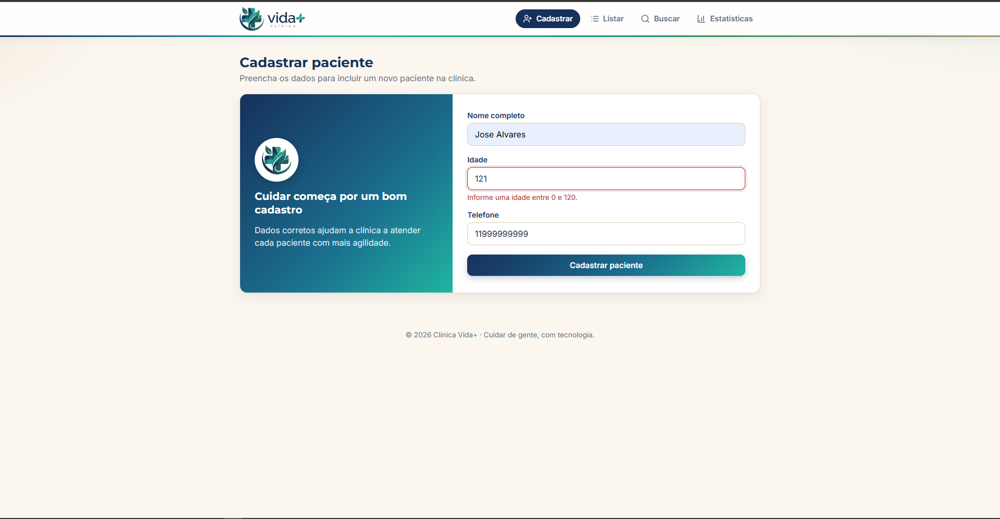
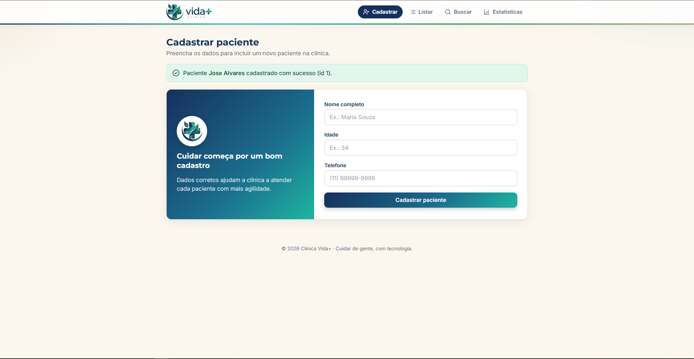
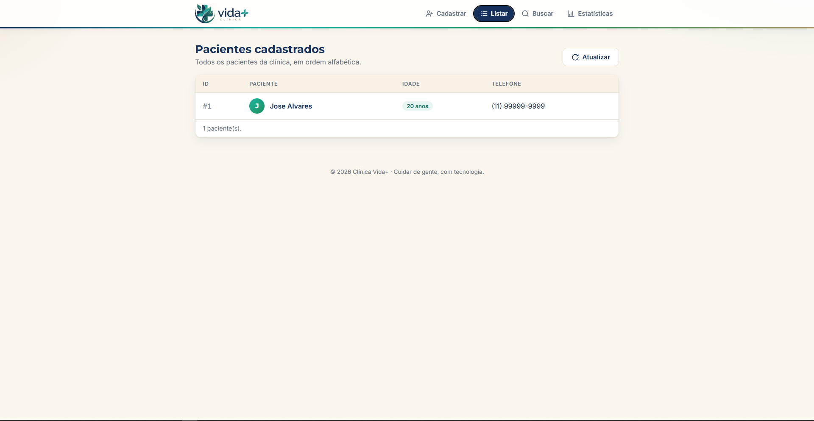
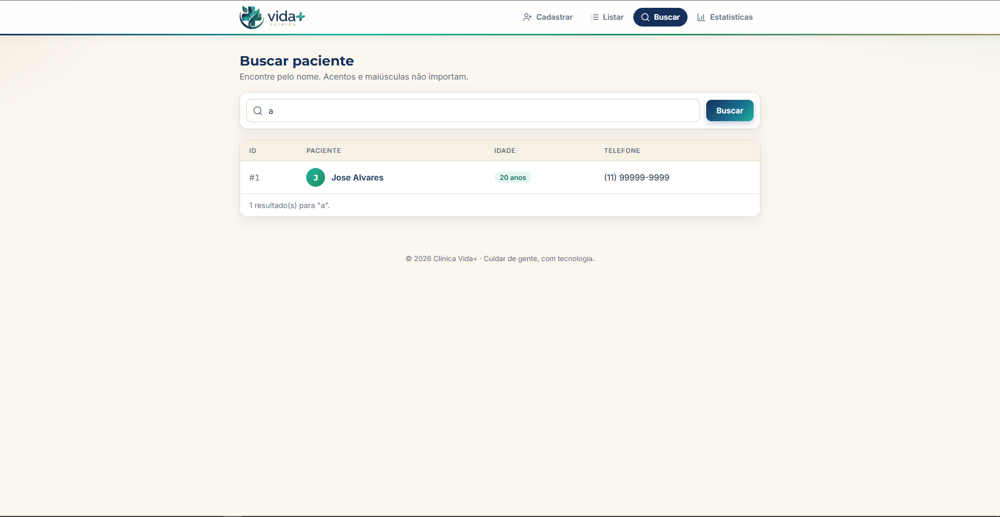
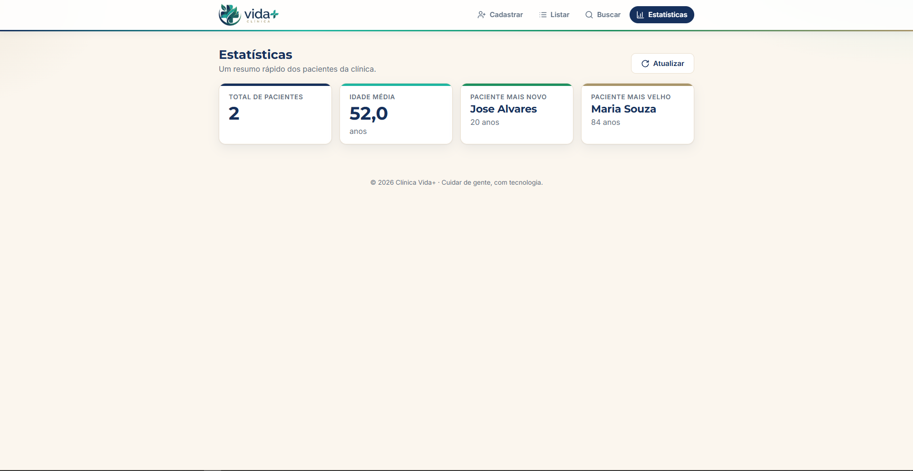
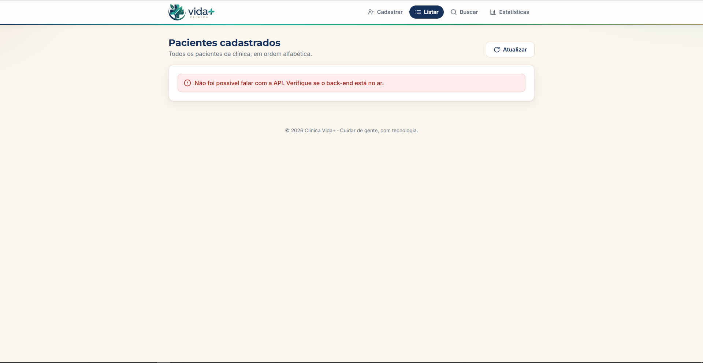
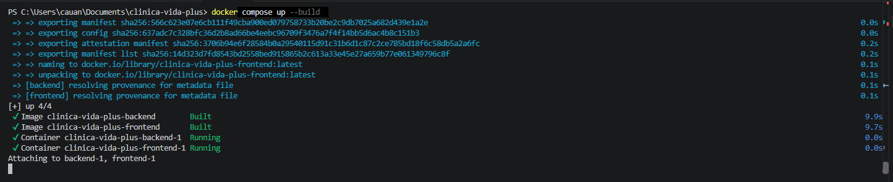

<p align="center">
  
</p>

# Clínica Vida+

Sistema de gestão de pacientes para clínicas: cadastro, listagem, busca por nome (sem diferenciar acentos nem maiúsculas) e estatísticas. O back-end é uma API REST em Spring Boot e o front-end é uma aplicação Angular. Os dois sobem juntos com um único comando, via Docker Compose.

## Tecnologias

| Camada | Tecnologias |
|---|---|
| Back-end | Java 21, Spring Boot 4, Maven, Bean Validation, SpringDoc (Swagger UI) |
| Front-end | Angular 22, TypeScript, Reactive Forms, Signals |
| Infra | Docker, Docker Compose, nginx |

## Como rodar

Requisito: Docker Desktop em execução.

```bash
git clone https://github.com/devmoraria/clinica-vida-plus.git
cd clinica-vida-plus
docker compose up --build
```

| Serviço | Endereço |
|---|---|
| Aplicação (front-end) | http://localhost:4200 |
| API (back-end) | http://localhost:8081 |
| Documentação Swagger | http://localhost:8081/swagger-ui.html |

O nginx do front-end repassa as chamadas de `/api` para o back-end, então o navegador só precisa acessar a porta 4200.

> Os dados ficam em memória. Ao parar e subir os containers de novo, a lista de pacientes volta vazia.

Para parar tudo: `Ctrl + C` e, se quiser remover os containers, `docker compose down`.

### Rodando sem Docker (desenvolvimento)

```bash
# back-end (porta 8081)
cd backend
./mvnw spring-boot:run

# front-end (porta 4200, com proxy de /api para a 8081)
cd frontend
npm install
ng serve
```

## Telas

### Cadastrar
Formulário com validação no front-end e exibição dos erros devolvidos pela API.

| Validação | Sucesso |
|---|---|
|  |  |

### Listar
Todos os pacientes em ordem alfabética, com estados de carregamento, lista vazia e erro.



### Buscar
Busca por parte do nome, sem diferenciar acentos nem maiúsculas (por exemplo, `ALVARO` encontra Álvaro Lima).



### Estatísticas
Total de pacientes, idade média, paciente mais novo e mais velho.



### API fora do ar
Se o back-end estiver indisponível, as telas mostram um aviso claro e se recuperam ao clicar em Atualizar, sem recarregar a página.



### Execução com Docker Compose



## API

Base URL: `http://localhost:8081`

| Método | Rota | Descrição |
|---|---|---|
| POST | `/api/pacientes` | Cadastra um paciente. Retorna `201` com o paciente criado ou `400` se os dados forem inválidos |
| GET | `/api/pacientes` | Lista todos os pacientes, ordenados por nome |
| GET | `/api/pacientes?nome=silva` | Busca por parte do nome, ignorando acentos e maiúsculas. Sem resultados, retorna `[]` |
| GET | `/api/pacientes/estatisticas` | Retorna `total`, `idadeMedia`, `maisNovo` e `maisVelho` |

Corpo do cadastro:

```json
{
  "nome": "João Silva",
  "idade": 45,
  "telefone": "(11) 99999-9999"
}
```

Resposta de um paciente:

```json
{
  "id": 1,
  "nome": "João Silva",
  "idade": 45,
  "telefone": "(11) 99999-9999"
}
```

A API também responde `400` de forma limpa quando o JSON tem tipo errado (por exemplo, `"idade": "quarenta"`). Exemplos prontos de todas as requisições estão em [`backend/requests.http`](backend/requests.http), para usar com a extensão REST Client do VS Code.

## Estrutura do projeto

```
clinica-vida-plus/
├── backend/             API Spring Boot (Maven) + Dockerfile
│   ├── src/
│   └── requests.http    exemplos de requisições
├── frontend/            Aplicação Angular + Dockerfile + nginx.conf
│   ├── src/app/
│   │   ├── models/      interfaces dos pacientes e estatísticas
│   │   ├── services/    PacienteService (chamadas à API)
│   │   └── pages/       cadastrar, listar, buscar, estatisticas
│   └── public/          logo e arquivos estáticos
├── docs/prints/         capturas de tela usadas neste README
└── docker-compose.yml   sobe front-end (4200) e back-end (8081)
```

## Autor

Desenvolvido por Cauan Morária — [@devmoraria](https://github.com/devmoraria).
